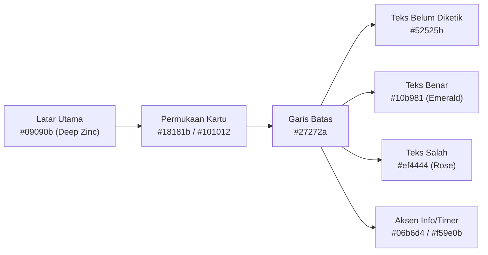
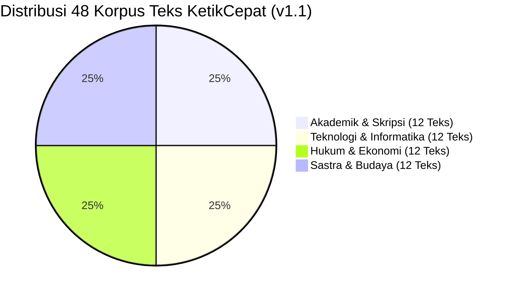

# Dokumentasi Produk: KetikCepat (v1.1)
### Aplikasi Simulasi Latihan Mengetik 10 Jari Berbasis Teks Akademik & Konten Lokal Indonesia

---

## 1. Ringkasan Eksekutif & Pembaruan Sistem (v1.1)

**KetikCepat** adalah platform simulasi pengetikan 10 jari modern (*touch-typing platform*) yang dibangun murni di sisi klien (*client-side*). Pada versi 1.1, aplikasi mendapatkan pembaruan fundamental berdasarkan umpan balik performa pengguna:

1. **Bank Kata Masif & Pengacakan Dinamis**:
   - Bank kata ditingkatkan menjadi **12 paragraf berbobot per kategori (total 48 korpus teks)**.
   - Tombol **"Ulangi"** (atau pintasan **Tab + Enter**) tidak lagi hanya mengulang teks yang sama, melainkan **mengganti teks dan mengacak susunan kalimat/kata** menggunakan algoritma *Fisher-Yates Shuffle*. Setiap sesi pengetikan dijamin menyajikan urutan kata yang baru dan menantang.
2. **Penanganan AFK (Away From Keyboard) & Zero Metrics**:
   - Saat pengguna berhenti mengetik selama lebih dari 4 detik saat sesi aktif, waktu akan **dijeda otomatis (*idle pause*)**.
   - Jika sesi berakhir tanpa ada aktivitas pengetikan yang cukup ($< 5$ karakter), metrik **disetel ke NOL (0 WPM, 0% Akurasi, 0% Konsistensi)** dan **TIDAK dimasukkan ke dalam riwayat `localStorage`** guna menjaga integritas data latihan pengguna.
3. **Penyempurnaan Posisi Kursor (*Precise Caret Alignment*)**:
   - Elemen `#caret` dipindahkan langsung ke dalam kontainer `.text-viewport` sehingga kalkulasi koordinat `left` dan `top` bersandar pada sistem koordinat lokal yang identik dengan elemen huruf. Kursor kini berdiri tegak tepat di depan dan sejajar sempurna dengan karakter target tanpa pergeseran vertikal (*zero vertical offset displacement*).

---

## 2. Arsitektur Teknis & Struktur Berkas

Aplikasi dirancang dengan pemisahan peran (*separation of concerns*) yang bersih tanpa dependensi eksternal atau kerangka kerja berat:

```
Literasi Digital Prototipe Produk/
├── index.html           # Struktur semantik HTML5, SVG inline, Google Fonts, & modal
├── style.css            # Desain Dark Mode (#09090b), variabel CSS, kursor meluncur, spotlight
├── data.js              # Bank 48 korpus teks & konfigurasi layout 10 jari standar
├── script.js            # Engine pengetikan, pengacak Fisher-Yates, deteksi AFK, audio sintetis
├── DOKUMENTASI_PRODUK.md# Dokumentasi teknis & spesifikasi produk di repositori
└── README.md            # Panduan pengoperasian cepat
```

---

## 3. Desain Sistem & Komponen UI/UX Motion

KetikCepat menerapkan estetika **Dark Mode Minimalis** dengan palet warna kontras tinggi:



### 🌟 Komponen & Mikro-Interaksi (ReactBits.dev Style)

#### 1. Smooth Caret (Kursor Meluncur Presisi)
- **Implementasi**: Elemen kursor `<div id="caret">` berada langsung di dalam `#textViewport` dengan transisi fisik:
  ```css
  transition: left 0.08s cubic-bezier(0.22, 1, 0.36, 1),
              top 0.08s cubic-bezier(0.22, 1, 0.36, 1),
              height 0.08s ease;
  ```
- **Kompensasi Koordinat Lokal**:
  $$\text{leftPos} = \text{spanRect.left} - \text{viewportRect.left} + \text{scrollLeft}$$
  $$\text{topPos} = \text{spanRect.top} - \text{viewportRect.top} + \text{scrollTop}$$
  $$\text{caretHeight} = \text{spanRect.height}$$
  Menghilangkan kesalahan *parent padding offset* dan menjamin kursor berdiri tepat sejajar dari puncak hingga dasar karakter aktif.

#### 2. Spotlight Bento Cards
- Kartu statistik pasca-latihan memanfaatkan variabel CSS `--mouse-x` dan `--mouse-y` yang diperbarui saat event `mousemove`. Efek `radial-gradient` memancarkan pendaran cahaya lembut yang mengikuti kursor pengguna saat menjelajahi statistik.

#### 3. Blur-Text Reveal
- Layar hasil dianimasikan menggunakan `@keyframes blurTextReveal` yang melakukan interpolasi dari `filter: blur(8px); transform: translateY(12px); opacity: 0;` ke kondisi tajam `filter: blur(0); opacity: 1;`.

#### 4. Sliding Pill Tab Switcher
- Pemilih kategori dan durasi menggunakan elemen *glider* absolut yang bergeser secara pegas menggunakan kurva `cubic-bezier(0.34, 1.56, 0.64, 1)` saat pengguna berpindah tab.

#### 5. Animated Number Ticker
- Perhitungan angka Net WPM, persentase akurasi, dan konsistensi digerakkan menggunakan `requestAnimationFrame` dengan fungsi pelambatan kubik (*cubic ease-out*) selama 1000ms saat layar hasil dibuka.

#### 6. SideRays Dynamic WebGL Background (ReactBits.dev)
- Latar belakang grafis menggunakan kanvas WebGL shader volumetrik murni tanpa dependensi eksternal. Menghasilkan berkas sinar dinamis dengan warna Emerald (`#10b981`) dan Cyan (`#06b6d4`) yang bergelombang secara sinusoidal dan merespons interaksi koordinat kursor mouse (*mouse tilt*).

---

## 4. Bank Korpus Teks Bahasa Indonesia (48 Teks)

Tersedia **48 paragraf berbobot** yang terbagi rata ke dalam 4 kategori spesifik:



1. **Akademik & Skripsi (12 Teks)**: Metodologi kuantitatif, sintesis tinjauan pustaka, uji Kolmogorov-Smirnov, hipotesis kausalitas, triangulasi kualitatif, etika publikasi APA, implikasi manajerial, paradigma hermeneutika, teknik sampling probabilitas, pemodelan persamaan struktural (SEM), validasi konstruk Fornell-Larcker, dan meta-analisis.
2. **Teknologi & Informatika (12 Teks)**: Notasi Big O, arsitektur transformator & AI, komputasi awan Kubernetes, zero trust & TLS, teorema CAP NoSQL, kedaulatan digital, edge computing, prinsip SOLID & desain pola, arsitektur konkurensi coroutine, broker pesan Kafka, keamanan rantai pasok CI/CD, dan GraphQL vs REST.
3. **Hukum & Ekonomi (12 Teks)**: Kebijakan fiskal ekspansif, transmisi moneter & inflasi, asas legalitas pidana, tata kelola korporasi (GCG), hierarki perundang-undangan UUD 1945, ekonomi kerakyatan UMKM, arbitrase dagang internasional, perlindungan konsumen, teori portofolio modern, persaingan usaha tidak sehat KPPU, ketahanan agraria, dan AMDAL lingkungan.
4. **Sastra & Budaya (12 Teks)**: Sumpah Pemuda & morfologi bahasa, sastra lisan Nusantara, puitika memori kota metropolitan, literasi kritis era digital, filosofi tenun ikat, dialog kebudayaan antargenerasi, arsitektur vernakular panggung, metafora puisi batin, diplomasi rempah pinisi, filosofi wayang kulit, kosmologi hutan adat, dan esai budaya warung kopi.

---

## 5. Mesin Kalkulasi & Logika Proteksi AFK

### 🛡️ Proteksi Sesi AFK (Away From Keyboard)
- **Idle Pause**: Timer berhenti sementara jika pengguna tidak menekan tombol apa pun selama 4 detik.
- **Validasi Penyimpanan Riwayat**:
  - Jika $\text{Total Karakter} < 5$ atau $\text{Karakter Benar} = 0$:
    - $\text{Net WPM} = 0$, $\text{Raw WPM} = 0$.
    - $\text{Akurasi} = 0\%$ (bukan 100%).
    - $\text{Konsistensi} = 0\%$ (bukan 100%).
    - **Sesi TIDAK disimpan** ke dalam `localStorage`.
    - Muncul banner peringatan: `⚠️ Sesi Tidak Disimpan (Terdeteksi AFK)`.

### 📊 Rumus Metrik Pengetikan Valid
$$\text{Raw WPM} = \frac{\text{Total Karakter Diketik} / 5}{\text{Waktu (detik)} / 60}$$
$$\text{Net WPM} = \max\left(0, \frac{(\text{Karakter Benar} - \text{Karakter Salah}) / 5}{\text{Waktu (detik)} / 60}\right)$$
$$\text{Akurasi} = \left(\frac{\text{Karakter Benar}}{\text{Total Karakter Diketik}}\right) \times 100\%$$
$$\text{Konsistensi} = \max\left(0, \min\left(100, \left(1 - \frac{\sigma}{\mu}\right) \times 100\right)\right)$$

---

## 6. Panduan Menjalankan

Cukup buka folder proyek dan **klik dua kali (*double click*) pada file `index.html`** di browser apa pun tanpa memerlukan Node.js atau web server.
