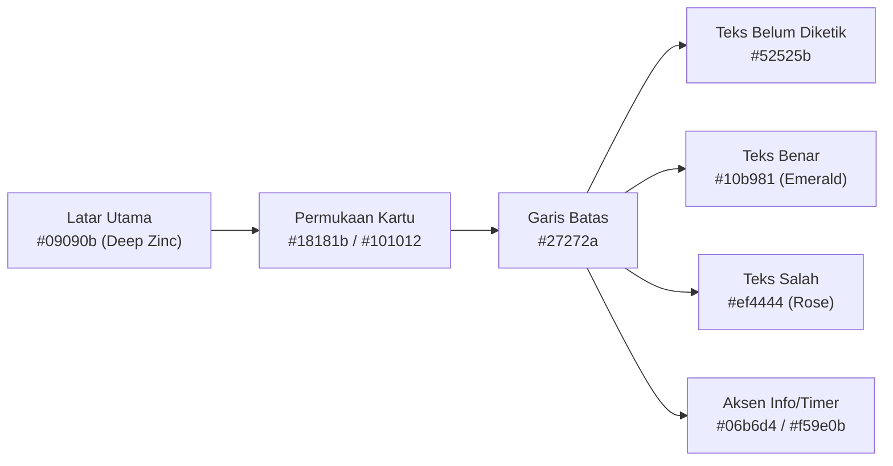
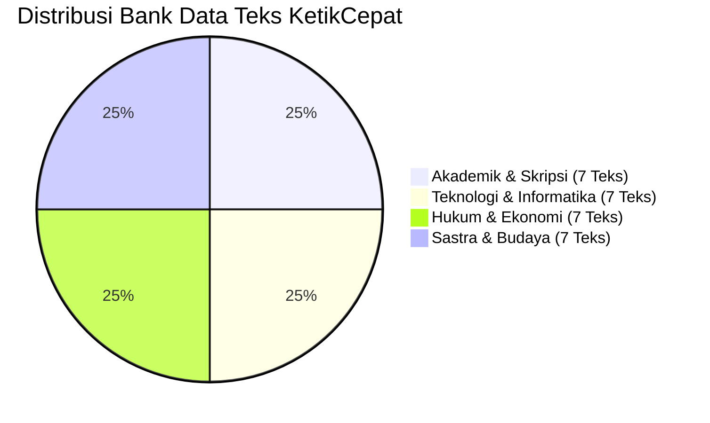

# Dokumentasi Produk: KetikCepat (v1.0)
### Aplikasi Simulasi Latihan Mengetik 10 Jari Berbasis Teks Akademik & Konten Lokal Indonesia

---

## 1. Ringkasan Eksekutif & Visi Produk

**KetikCepat** adalah platform simulasi pengetikan 10 jari modern (*touch-typing platform*) yang dibangun murni di sisi klien (*client-side*). Berbeda dengan simulator pengetikan konvensional yang didominasi oleh kata-kata acak berbahasa Inggris tanpa konteks, KetikCepat dirancang khusus menggunakan **korpus teks akademik, profesional, dan kultural berbahasa Indonesia baku** dengan terminologi tingkat lanjut.

### 🎯 Nilai Utama (Value Proposition)
1. **Relevansi Kontekstual Tinggi**: Melatih refleks pengetikan pada istilah skripsi, metodologi riset, teknologi informasi, regulasi hukum, makroekonomi, dan esai sastra Indonesia.
2. **Estetika & Fisika Gerak Modern**: Mengadopsi standar mikro-interaksi komponen interaktif **reactbits.dev** (Spotlight Bento Cards, Blur-Text Reveal, Smooth Caret, Number Ticker, dan Sliding Glider).
3. **Privasi & Portabilitas 100% (Zero-Backend)**: Seluruh data latihan tersimpan lokal di peramban (`localStorage`) tanpa server luar, tanpa pelacak data, dan dapat langsung dibuka via protokol `file:///` cukup dengan klik dua kali pada berkas `index.html`.
4. **Metrik Standar Internasional**: Menggunakan algoritma baku *Net WPM* (5 karakter/kata dikurangi penalti kesalahan), *Accuracy Rate*, *Typing Consistency*, dan *Typo Tracker*.

---

## 2. Arsitektur Teknis & Struktur Proyek

Aplikasi dirancang dengan pemisahan keprihatinan (*separation of concerns*) yang bersih tanpa dependensi eksternal, bundler, atau kerangka kerja berat:

```
Literasi Digital Prototipe Produk/
├── index.html           # Struktur semantik HTML5, SVG inline, Google Fonts, & modal
├── style.css            # Desain Dark Mode (#09090b), variabel CSS, kursor meluncur, spotlight
├── data.js              # Bank korpus teks 4 kategori & konfigurasi layout 10 jari standar
├── script.js            # Typing engine, audio sintetis, smooth caret, ticker, & localStorage
├── DOKUMENTASI_PRODUK.md# Dokumentasi teknis & spesifikasi produk
└── README.md            # Panduan pengoperasian cepat
```

### 🔧 Rincian Komponen Arsitektur:
- **`index.html`**: Menyediakan kerangka semantik yang aksesibel, dialog modal bawaan, tombol navigasi, dan SVG inline yang 100% *offline-ready* tanpa risiko kegagalan unduh CDN ikon.
- **`style.css`**: Sistem gaya berbasis CSS Custom Properties (CSS Variables), tata letak Flexbox dan CSS Grid adaptif, serta `@keyframes` animasi fisik.
- **`data.js`**: Objek data `window.TYPING_DATA` yang memuat seluruh dataset paragraf, konfigurasi tombol QWERTY, koordinat baris taktil, serta pemetaan 9 zona warna jari.
- **`script.js`**: Mengelola *finite state machine* siklus latihan (IDLE, ACTIVE, FINISHED), penanganan event `keydown`/`keyup`, mesin suara Web Audio API, kalkulasi metrik WPM, dan manipulasi DOM secara efisien.

---

## 3. Desain Sistem & Komponen UI/UX Motion

KetikCepat menerapkan estetika **Dark Mode Minimalis** dengan palet warna kontras tinggi yang nyaman di mata untuk sesi latihan berdurasi panjang:



### 🌟 Komponen & Mikro-Interaksi (ReactBits.dev Style)

#### 1. Smooth Caret (Kursor Meluncur Presisi)
- **Implementasi**: Elemen kursor `<div id="caret">` dengan transisi fisik:
  ```css
  transition: left 0.08s cubic-bezier(0.22, 1, 0.36, 1),
              top 0.08s cubic-bezier(0.22, 1, 0.36, 1),
              height 0.08s ease;
  ```
- **Kompensasi Vertikal Dinamis**: Tinggi kursor dikunci proporsional terhadap *cap-height* huruf (`fontSize * 1.25 ≈ 25px`), dan posisinya dihitung otomatis:
  $$\text{topPos} = \text{spanRect.top} - \text{viewportRect.top} + \text{scrollTop} + \frac{\text{spanRect.height} - \text{caretHeight}}{2}$$
  Hal ini menjamin kursor selalu berdiri tegak sejajar dan pas di depan karakter aktif tanpa melorot ke bawah.

#### 2. Spotlight Bento Cards
- Kartu statistik pasca-latihan memanfaatkan variabel CSS `--mouse-x` dan `--mouse-y` yang diperbarui saat event `mousemove`. Efek `radial-gradient` memancarkan pendaran cahaya lembut yang mengikuti kursor pengguna saat menjelajahi statistik.

#### 3. Blur-Text Reveal
- Layar hasil dianimasikan menggunakan `@keyframes blurTextReveal` yang melakukan interpolasi dari `filter: blur(8px); transform: translateY(12px); opacity: 0;` ke kondisi tajam `filter: blur(0); opacity: 1;`.

#### 4. Sliding Pill Tab Switcher
- Pemilih kategori dan durasi menggunakan elemen *glider* absolut yang bergeser secara pegas menggunakan kurva `cubic-bezier(0.34, 1.56, 0.64, 1)` saat pengguna berpindah tab.

#### 5. Animated Number Ticker
- Perhitungan angka Net WPM, persentase akurasi, dan konsistensi digerakkan menggunakan `requestAnimationFrame` dengan fungsi pelambatan kubik (*cubic ease-out*) selama 1000–1200ms saat layar hasil dibuka.

#### 6. Interactive Virtual Keyboard (Panduan 10 Jari)
- Menampilkan 5 baris tombol QWERTY standar dengan pembagian 9 zona warna jari:
  - **Kelingking Kiri** (`#ec4899`): Tombol `~`, `1`, `Q`, `A`, `Z`, `Tab`, `Caps`, `Shift`.
  - **Jari Manis Kiri** (`#a855f7`): Tombol `2`, `W`, `S`, `X`.
  - **Jari Tengah Kiri** (`#3b82f6`): Tombol `3`, `E`, `D`, `C`.
  - **Telunjuk Kiri** (`#10b981`): Tombol `4`, `5`, `R`, `T`, `F`, `G`, `V`, `B` (Tonjolan taktil di `F`).
  - **Kedua Ibu Jari** (`#94a3b8`): Tombol `Spasi`.
  - **Telunjuk Kanan** (`#14b8a6`): Tombol `6`, `7`, `Y`, `U`, `H`, `J`, `N`, `M` (Tonjolan taktil di `J`).
  - **Jari Tengah Kanan** (`#06b6d4`): Tombol `8`, `I`, `K`, `,`.
  - **Jari Manis Kanan** (`#f59e0b`): Tombol `9`, `O`, `L`, `.`.
  - **Kelingking Kanan** (`#f43f5e`): Tombol `0`, `-`, `=`, `P`, `[`, `]`, `\`, `;`, `'`, `Enter`, `/`.

---

## 4. Bank Korpus Teks Bahasa Indonesia

Tersedia **28 paragraf lengkap** yang terbagi ke dalam 4 kategori spesifik:



1. **Akademik & Skripsi**:
   - Istilah: *Kuesioner Likert, korelasi Pearson, regresi linear berganda, Cronbach Alpha, validitas konstruk, research gap, kerangka teoretis, uji Kolmogorov-Smirnov, Variance Inflation Factor (VIF), triangulasi fenomenologis, reduksi data, APA edisi ketujuh*.
2. **Teknologi & Informatika**:
   - Istilah: *Notasi Big O, quicksort, arsitektur transformator, mekanisme atensi, penurunan stokastik (SGD), layanan mikro Docker, orkestrasi Kubernetes, zero trust, enkripsi RSA, TLS, teorema CAP, NoSQL, kedaulatan digital, edge computing*.
3. **Hukum & Ekonomi**:
   - Istilah: *Kebijakan fiskal ekspansif, bauran moneter, valuta asing, inflasi bergejolak, asas legalitas hukum pidana, yurisprudensi Mahkamah Agung, kepatuhan pasar modal, UUD 1945, pengujian materiil Mahkamah Konstitusi, UMKM, arbitrase komersial*.
4. **Sastra & Budaya**:
   - Istilah: *Sumpah Pemuda, kelenturan morfologi, khazanah sastra tradisional, pantun Melayu, tembang macapat Jawa, puitika urban metropolitan, literasi kritis, filosofi motif kain tenun ikat, kearifan ekologis arsitektur vernakular*.

---

## 5. Mesin Kalkulasi & Metrik Pengetikan

KetikCepat menerapkan standardisasi pengetikan formal:

### 1. Raw WPM (Gross Speed)
Mengukur total seluruh karakter yang diketik dibagi 5 (standar 1 kata internasional) per menit tanpa memperhitungkan kesalahan:
$$\text{Raw WPM} = \frac{\text{Total Karakter Diketik} / 5}{\text{Waktu (detik)} / 60}$$

### 2. Net WPM (Kecepatan Bersih)
Mengukur kecepatan efektif dengan mengurangi penalti atas karakter yang salah:
$$\text{Net WPM} = \max\left(0, \frac{(\text{Karakter Benar} - \text{Karakter Salah}) / 5}{\text{Waktu (detik)} / 60}\right)$$

### 3. Akurasi Pengetikan (%)
$$\text{Akurasi} = \left(\frac{\text{Karakter Benar}}{\text{Total Karakter Diketik}}\right) \times 100\%$$

### 4. Konsistensi Pengetikan (%)
Diukur berdasarkan koefisien variasi (*Coefficient of Variation - CV*) dari rekaman WPM setiap interval 1 detik:
$$\text{Mean} (\mu) = \frac{\sum \text{WPM}_t}{N}, \quad \text{StdDev} (\sigma) = \sqrt{\frac{\sum (\text{WPM}_t - \mu)^2}{N}}$$
$$\text{Konsistensi} = \max\left(0, \min\left(100, \left(1 - \frac{\sigma}{\mu}\right) \times 100\right)\right)$$

### 5. Benchmark Level Kecepatan (Speed Tiers)
- **$\ge 80$ WPM**: *Master Typist (Ahli)* — Kecepatan setara juru ketik profesional.
- **$65 - 79$ WPM**: *Sangat Cepat (Pro)* — Sangat produktif untuk koding dan karya tulis ilmiah.
- **$45 - 64$ WPM**: *Mahir (Fluent)* — Di atas rata-rata kecepatan pengetik dunia kerja.
- **$30 - 44$ WPM**: *Menengah (Intermediate)* — Kecepatan mengetik fungsional harian.
- **$< 30$ WPM**: *Pemula (Developing)* — Tahap pembentukan memori otot 10 jari.

---

## 6. Fitur Pendukung & Audio Engine

### 🔊 Sintesis Suara Ketik (Web Audio API)
- Menggunakan osilator bawaan browser (`sine` wave frekuensi 520Hz dengan decay eksponensial ke 190Hz dalam 35ms) untuk menghasilkan suara *thock* empuk layaknya sakelar keyboard mekanikal.
- Suara kesalahan (*error*) disintesis menggunakan gelombang `sawtooth` frekuensi rendah 140Hz ke 70Hz.
- Akord harmoni kemenangan (*victory chime*) empat nada [C5, E5, G5, C6] saat menyelesaikan tes.
- Tidak memerlukan berkas eksternal `.mp3`/`.wav`, sehingga hemat memori dan instan tanpa latensi unduh.

### ⌨️ Pintasan Keyboard (Shortcuts)
- **Tab + Enter**: Mengulang (*restart*) sesi seketika.
- **Ctrl + Backspace**: Menghapus satu kata penuh sekaligus.
- **Spasi**: Maju ke kata berikutnya tanpa menyebabkan halaman web bergulir ke bawah (*prevent scroll*).
- **Auto-Focus Cerdas**: Mengetuk area mana pun pada kartu pengetikan akan langsung mengembalikan fokus input pengetikan.

---

## 7. Riwayat Progres & Ekspor Bukti Latihan

1. **Penyimpanan Lokal (`localStorage`)**:
   - Menyimpan otomatis 10 sesi terakhir dengan skema objek JSON lengkap (timestamp, judul teks, durasi, WPM, akurasi, konsistensi, karakter benar/salah, dan karakter paling sering keliru).
2. **Grafik Batang Visual Tren**:
   - Modal riwayat dilengkapi diagram batang CSS Flex yang menunjukkan kurva peningkatan Net WPM dari sesi ke sesi secara kronologis.
3. **Ekspor CSV**:
   - Menghasilkan berkas `.csv` ber-encoding `UTF-8 with BOM` yang dapat langsung dibuka dengan sempurna di Microsoft Excel, Google Sheets, atau Numbers tanpa karakter rusak.
4. **Salin Ringkasan Clipboard**:
   - Menyalin format ringkasan nilai latihan siap tempel untuk laporan tugas atau portofolio literasi digital.

---

## 8. Panduan Menjalankan Aplikasi

Aplikasi tidak memerlukan instalasi Node.js, npm, ataupun server lokal:
1. Buka folder proyek pada File Explorer.
2. Klik dua kali (*double click*) pada berkas **`index.html`**.
3. Aplikasi langsung terbuka di peramban utama Anda dan siap digunakan secara instan!

